<p align="center">
  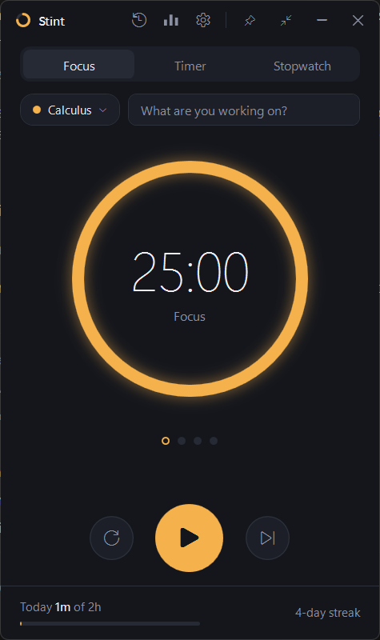
</p>

<h1 align="center">Stint</h1>

<p align="center">
  A compact study timer for Windows that remembers what you studied.<br>
  Focus blocks, a plain timer and a stopwatch, plus a log and stats of your study time.
</p>

<p align="center">
  <a href="https://github.com/Ammar32614/TimerApp/releases/latest"><b>Download for Windows</b></a>
  &nbsp;·&nbsp;
  <a href="#features">Features</a>
  &nbsp;·&nbsp;
  <a href="#building-from-source">Build from source</a>
</p>

---

## Install

1. Go to the [latest release](https://github.com/Ammar32614/TimerApp/releases/latest).
2. Download **`Stint-Setup-<version>.exe`** and run it.
   - It installs for your account only, so you don't need admin rights. You'll find it in the Start menu as **Stint**.
   - Prefer no installer? Download the **portable zip** instead, unzip it and run `Stint.exe`.
3. The first time, Windows may say **"Windows protected your PC"**. Stint isn't code-signed, which costs money for a hobby project. Click **More info → Run anyway**.

Requires Windows 10 or 11 (64-bit). .NET is bundled, so there's nothing else to install.

To uninstall, use **Settings → Apps → Installed apps → Stint**. Your study log is kept, in case you reinstall later.

## Features

| Focus | Timer | Stopwatch |
|---|---|---|
|  | 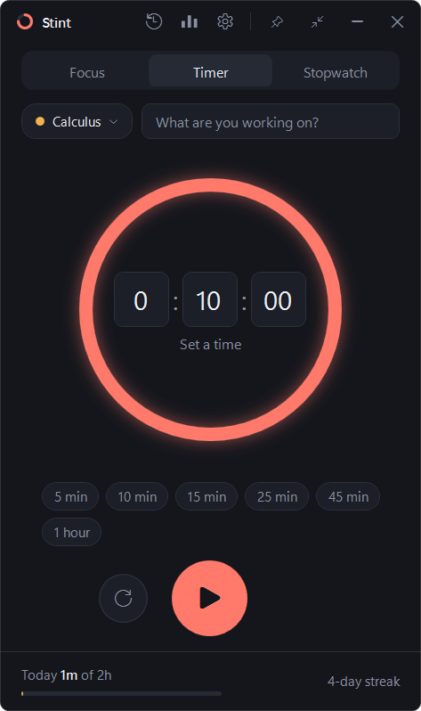 | 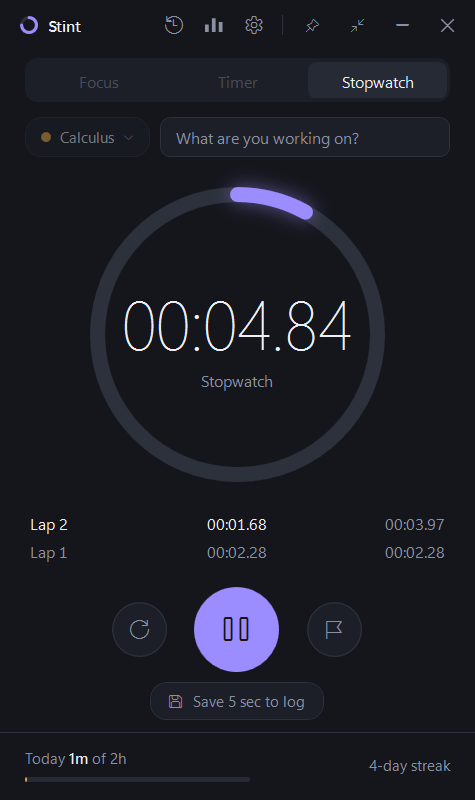 |

- **Focus mode**: Pomodoro-style blocks with short breaks and a long break every 4 blocks. You can change all of these in Settings. The dots under the ring show where you are in the cycle.
- **Timer**: a plain countdown, with presets from 5 minutes to 1 hour.
- **Stopwatch**: with lap times.
- **Save to log any time**: whenever a run has time on it, a **Save to log** button appears in every mode. It records exactly the time so far, so you don't have to finish the full block.
- **Subjects and descriptions**: tag each session with a colour-coded subject and say what you're working on.
- **After-session check-in**: rate how focused you were (1–5) and leave a note for next time. You can skip it.

| Study log | Stats | After a session |
|---|---|---|
| 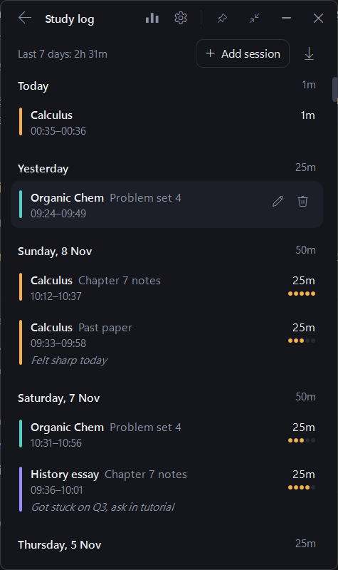 | 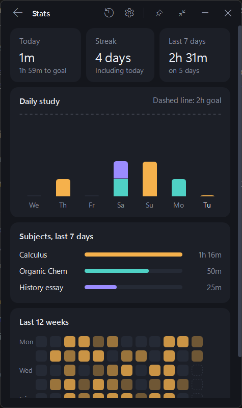 | 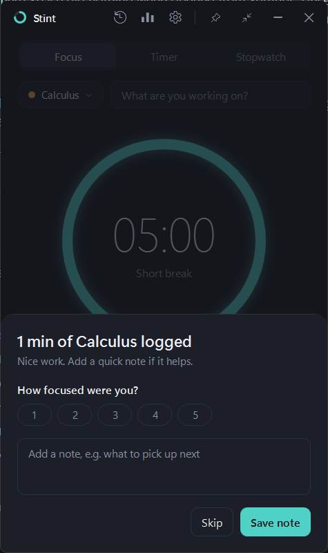 |

- **Study log**: every session grouped by day. You can edit or delete sessions (with undo), and add one by hand if you forgot to start the timer.
- **Stats**: today against your daily goal, your streak, daily bars by subject for the last 7 days, and a 12-week heatmap.
- **CSV export**: open your whole history in Excel or Google Sheets.
- **Stays out of the way**:
  - Windows notifications and a sound when time is up, plus a tray icon. You can pick your own alarm sound (WAV, MP3 or WMA).
  - **Keep on top** and **mini mode** (below).
  - An option to start Stint when you sign in.

<p align="center">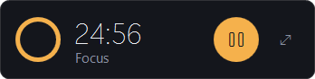</p>

### Themes

Pick one in **Settings → Appearance**. It changes instantly.

| Midnight | Daylight | Paper |
|---|---|---|
| 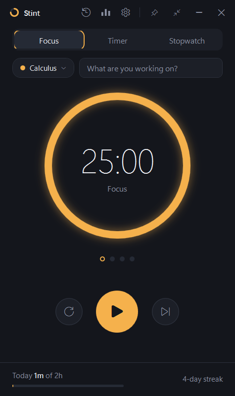 | 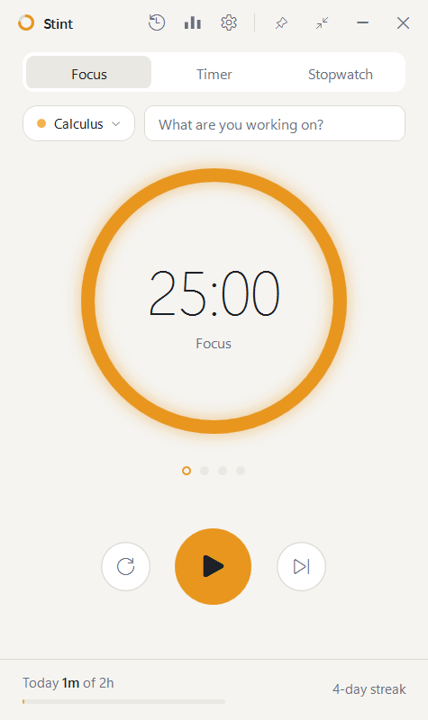 | 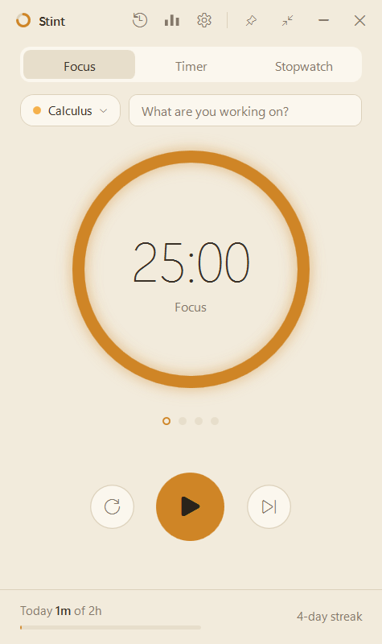 |

| Forest | Ocean | Dusk |
|---|---|---|
| 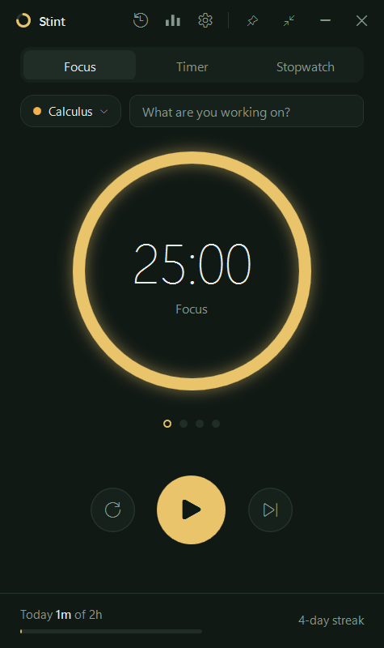 | 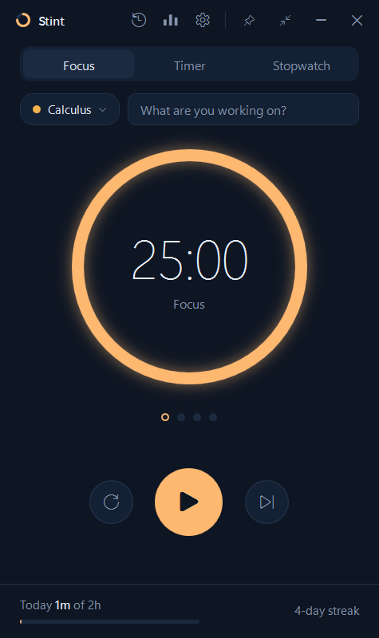 | 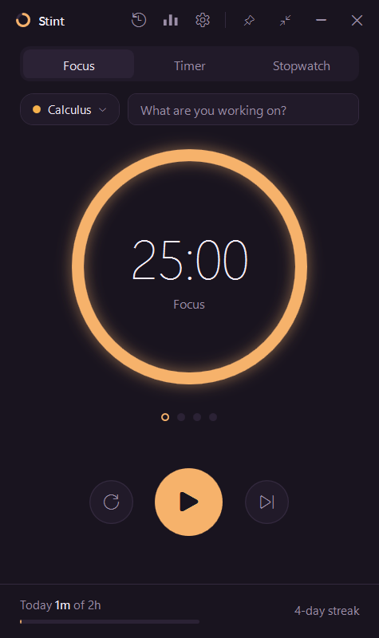 |

### Keyboard shortcuts

| Key | Action |
|---|---|
| `Space` | Start / pause |
| `Ctrl+S` | Save the run to your log |
| `R` | Discard the run (with Undo). Press again while stopped to restart the focus cycle. |
| `S` | Skip to the next focus phase |
| `L` | Lap (stopwatch) |
| `1` `2` `3` | Focus / Timer / Stopwatch |
| `Ctrl+L` | Study log |
| `Ctrl+T` | Stats |
| `Esc` | Back / close |

### What counts as study time

- A focus block or timer that runs to the end is logged automatically.
- At any point you can press **Save to log** (or `Ctrl+S`) to log the time so far. In Focus mode this ends the block early and moves on to the break.
- **Reset** discards the run. If that was a mistake, press **Undo** within a few seconds.
- If you close Stint mid-run, the run is still logged as long as it's at least a minute long.
- Breaks are never logged, and a session counts towards the day it started on.

## Your data

Everything stays on your PC in one file:

```
%AppData%\Stint\data.json
```

**Settings → Your data → Open data folder** takes you there. It's plain JSON, so you can back it up by copying the file. Stint saves after every change. Each save writes to a temporary file and then replaces the old one, so a crash can't leave the file half-written. If the file is ever damaged, Stint keeps a copy as `data.corrupt-<date>.json` and starts fresh.

Stint never connects to the internet.

## Building from source

You need the [.NET 10 SDK](https://dotnet.microsoft.com/download/dotnet/10.0) on Windows.

```bash
git clone https://github.com/Ammar32614/TimerApp.git
cd TimerApp
dotnet run --project TimerApp.csproj
```

Run the tests:

```bash
dotnet test TimerApp.Tests
```

Build the single-file exe that ships in releases:

```bash
dotnet publish TimerApp.csproj -c Release -r win-x64 --self-contained true -p:PublishSingleFile=true -p:IncludeNativeLibrariesForSelfExtract=true -p:EnableCompressionInSingleFile=true -o publish
```

Set the `STINT_DATA` environment variable to a file path to run against a separate data file, for example to try it with demo data.

### Project layout

| Path | What's there |
|---|---|
| `Models/` | Sessions, subjects, settings |
| `Services/` | Saving, the focus cycle, stats, CSV export, notifications, start-at-sign-in |
| `Views/` | The timer, log, stats and settings pages |
| `Themes/Theme.xaml` | Colours and control styles |
| `TimerApp.Tests/` | xUnit tests for the logic |
| `installer/Stint.iss` | Inno Setup installer script |
| `.github/workflows/` | CI, and the release build that runs when a `v*` tag is pushed |

### Making a release

```bash
git tag v1.0.1
git push origin v1.0.1
```

GitHub Actions runs the tests, builds the exe, the installer and the portable zip, and publishes them as a release. Release notes come from `.github/release-notes/<tag>.md` if that file exists.

## License

[MIT](LICENSE)
